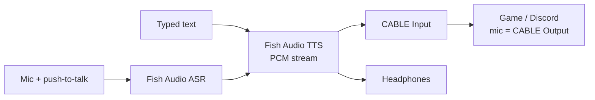

 <div align="center">

# AI TTS Soundboard

**Talk in-game with any Fish Audio voice — type it or just say it.**


[Features](#-features) •
[Quick start](#-quick-start) •
[Usage](#-usage) •
[Configuration](#%EF%B8%8F-configuration) •
[Latency](#%EF%B8%8F-latency) •
[Troubleshooting](#-troubleshooting) •
[RVC dataset](#-bonus-rvc-dataset-generator)

</div>

---

## ✨ Features

- **Type & send**: press <kbd>Enter</kbd> and the text is spoken right away over low-latency PCM streaming.
- **Push-to-talk**: hold a **global hotkey** (works while the game has focus) or the big on-screen button, speak, release. Your speech is transcribed and re-spoken in the selected voice.
- **Live latency readout**: speech-to-text, TTS first byte and total time for every message.
- **Warm connection**: the HTTPS connection to Fish Audio is kept alive and pre-opened while you type or hold push-to-talk.
- **Dual output**: plays to VB-CABLE (game/Discord mic) and, optionally, your headphones at the same time.
- **Auto-detects VB-CABLE**: `CABLE Input` is selected automatically.
- **Instant stop**: <kbd>F6</kbd> cuts playback and clears the queue.
- **Persistent settings**: everything is saved to `config.json`.
- **Non-blocking**: synthesis, transcription and playback run on background threads, so the UI never freezes.
- **Readable errors**: wrong API key, no credits, bad voice ID, no internet, missing VB-CABLE.

## How it works



## 🚀 Quick start

### 1. Requirements

| | |
|---|---|
| **OS** | Windows 10 / 11 |
| **Python** | 3.9+ |
| **Virtual cable** | [VB-CABLE](https://vb-audio.com/Cable/). Restart Windows after installing |
| **Account** | [Fish Audio](https://fish.audio) API key with credits |

### 2. Install

```bash
pip install fish-audio-sdk customtkinter sounddevice keyboard
```

### 3. Run

```bash
python app.py
```

> [!TIP]
> If global hotkeys don't fire while the game is focused, run the terminal **as Administrator**. Games running elevated or using raw input block hooks from non-elevated processes.

### 4. First-time setup

1. Paste your **API Key** (fish.audio → API Keys).
2. Paste the voice's **Reference ID**, the ID from the voice model page URL. Leave it empty to use the default voice.
3. Check that **Output (game mic)** is set to `CABLE Input [MME]`.
4. Optionally pick **Monitor (headphones)** to hear yourself.
5. Pick your **Microphone** for push-to-talk.
6. Click **Save & Apply** (pinned at the bottom of the **Settings** tab).
7. In the game / Discord, set the input device to **CABLE Output**.

## 🎮 Usage

### Hotkeys

| Key (default) | Action |
|---|---|
| <kbd>Enter</kbd> | Speak the typed message (app window focused) |
| <kbd>F7</kbd> *(hold)* | Push-to-talk: record while held, speak on release |
| <kbd>F6</kbd> | Stop playback and clear the queue |

Both hotkeys are configurable in **Settings**. Stop accepts any [`keyboard`](https://github.com/boppreh/keyboard) syntax (e.g. `ctrl+q`). Push-to-talk must be a **single key**. You can also hold the big 🎙 button with the mouse.

> [!NOTE]
> Hotkeys are **not suppressed**: the game still receives the keypress. Pick keys your game doesn't use.

### Push-to-talk details

- The mic stream stays open and keeps the last **~300 ms** buffered, so your first syllable isn't cut off.
- Clips shorter than **0.4 s** are ignored (accidental taps).
- The recognized text is spoken immediately, with no confirmation step, and shown under the latency tiles.
- `CABLE Output` is hidden from the microphone list to prevent feedback loops.
- Typical end-to-end delay: **~1–2 s** after releasing the key.

## ⚙️ Configuration

Settings live in `config.json` next to the script. Most fields are editable in the UI. These are file-only:

| Key | Default | Description |
|---|---|---|
| `model` | `s2.1-pro` | Fish Audio TTS model (e.g. `s2-pro`, `s2.1-pro-free`) |
| `latency` | `balanced` | `balanced` = faster, `normal` = higher quality |
| `stt_language` | `pl` | Speech recognition language. Empty string = auto-detect |

> [!WARNING]
> The API key is stored in **plain text**. Don't commit or share `config.json`.

<details>
<summary><b>Example <code>config.json</code></b></summary>

```json
{
  "api_key": "your-api-key",
  "reference_id": "your-voice-id",
  "model": "s2.1-pro",
  "latency": "balanced",
  "stt_language": "pl",
  "output_device": "CABLE Input (VB-Audio Virtual C [MME]",
  "monitor_device": "Headphones (Realtek(R) Audio) [MME]",
  "input_device": "(system default)",
  "ptt_hotkey": "f7",
  "stop_hotkey": "f6"
}
```

</details>

## 🔊 Audio pipeline

| Stage | Details |
|---|---|
| TTS format | PCM, 16-bit, mono, 44.1 kHz |
| Pre-buffer | ~150 ms before playback starts, to absorb network jitter |
| Outputs | One writer thread per device, so a slow device doesn't hold back the other |
| Host API | MME preferred, because it resamples. WASAPI may reject 44.1 kHz mono |
| Mic capture | 16 kHz mono, sent to ASR as WAV |

## ⏱️ Latency

The **Talk** tab shows three timings for the last message:

| Tile | Measured from → to |
|---|---|
| **Speech → text** | ASR request sent → transcript received (push-to-talk only) |
| **TTS first byte** | TTS request sent → first audio chunk received |
| **Total to audio** | Key release / <kbd>Enter</kbd> → audio handed to the output device (after the 150 ms pre-buffer) |

The device buffer and VB-CABLE add a few tens of ms on top. Discord or the game add their own network delay.

**Connection reuse.** By default `httpx` drops idle connections after 5 s, so every message after a pause would pay a new TCP + TLS handshake. The app uses one shared client with a 300 s keep-alive. It also sends a lightweight `HEAD` request to pre-open the connection when you start typing or press push-to-talk (throttled to once every 3 s), which covers the case where Fish Audio closes idle connections earlier on its side.

## 💰 Cost

| Service | Price | Example |
|---|---|---|
| TTS (`s2.1-pro`) | $15 / 1M UTF-8 bytes | A 30-character callout ≈ $0.0005 |
| ASR | ~$0.36 / audio hour | A 3-second phrase ≈ $0.0003 |

## 🩺 Troubleshooting

| Problem | Fix |
|---|---|
| `VB-CABLE ('CABLE Input') not found` | Install [VB-CABLE](https://vb-audio.com/Cable/), restart Windows, click **Refresh** |
| `Invalid API key (401)` | Re-copy the key from your Fish Audio account |
| `Insufficient account balance (402)` | Top up Fish Audio credits |
| `Voice not found (404)` | Check the **Reference ID** |
| Nobody hears me in-game | Game/Discord input must be **CABLE Output**, not CABLE Input |
| Hotkeys don't work in-game | Run as Administrator. Use borderless/windowed mode if the game blocks hooks |
| High "TTS first byte" | Usually network or server side. Check your connection |
| Audio device error on WASAPI | Choose the `[MME]` variant of the device |
| Choppy audio | Network jitter. Increase `PREBUFFER_BYTES` in the script |

## 🧪 Bonus: RVC dataset generator

`make_dataset.py` generates WAV clips (44.1 kHz, 16-bit mono) with your Fish Audio voice, ready for training an [RVC](https://github.com/IAHispano/Applio) model for real-time voice conversion.

```bash
python make_dataset.py corpus.txt dataset --target-minutes 20
```

| Argument | Default | Description |
|---|---|---|
| `text_file` | | Long, varied text in the language you'll speak |
| `output_dir` | | Folder for `0001.wav`, `0002.wav`, … |
| `--chunk-chars` | `220` | Max characters per clip (split on sentence boundaries) |
| `--target-minutes` | `20` | Stop once this much audio exists |

- Uses `config.json` from the main app (API key, voice, model).
- **Resumable**: re-running skips clips that already exist.
- Uses `latency="normal"` (quality over speed). Rate limits and network errors are retried with backoff.

## 📁 Project structure

```
.
├── fish_tts_soundboard.py   # GUI app: TTS, push-to-talk, latency readout
├── make_dataset.py          # RVC training dataset generator
├── config.json              # created on first save (gitignore it!)
└── README.md
```

---

<div align="center">
<sub>Built with <a href="https://docs.fish.audio">Fish Audio</a> · <a href="https://github.com/TomSchimansky/CustomTkinter">CustomTkinter</a> · <a href="https://python-sounddevice.readthedocs.io">sounddevice</a> · <a href="https://github.com/boppreh/keyboard">keyboard</a></sub>
</div>
